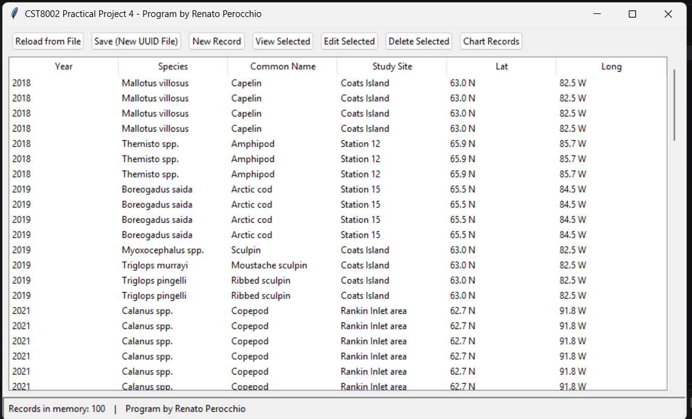
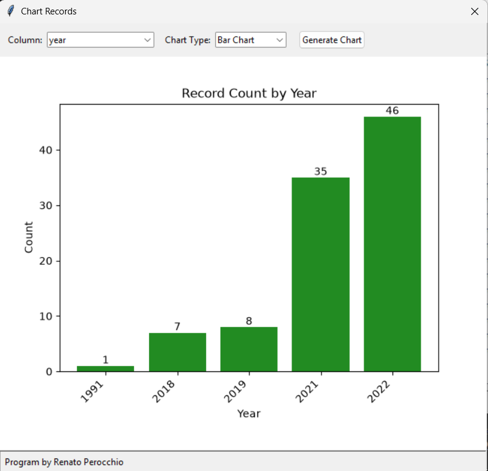

# Prey Records Manager (Python desktop app)

A Python desktop app for browsing and editing a Fisheries and Oceans Canada research dataset. It loads the records from a CSV file and shows them in a table. You can create, view, edit and delete records, save your changes to a new file, and chart the records by any column.

This was my solo project for **CST8002 Programming Language Research Project** at Algonquin College (Spring/Summer 2026). I built it in four milestones between May and August 2026.





## What it does

- Loads the dataset from CSV when it starts, and can reload it on demand.
- Shows the records in a table, with a status bar that shows how many records are in memory.
- Creates, views, edits and deletes records through dialog windows.
- Saves the current records to a new CSV file with a unique (UUID) name, so the original data is never overwritten.
- Draws bar or pie charts of record counts for a chosen column (for example by year, species or study site). The charts use matplotlib, embedded in the Tkinter window.

## How it's built

The code is split into four layers so each part has one job:

| Folder | Layer | What it holds |
|---|---|---|
| `model/` | Model | `PreyRecord`, the class for one row of the dataset |
| `persistence/` | File storage | Reading the CSV and writing new UUID-named files |
| `business/` | Business logic | `RecordManager`: create, read, update, delete, and `count_by_column()` for charts |
| `presentation/` | Interface | The Tkinter window and dialogs (`gui.py`) and the chart view (`chart_view.py`) |
| `tests/` | Tests | `unittest` tests for the record operations |

The interface holds no data logic. For example, the chart window asks `RecordManager.count_by_column()` for the counts and only draws them.

## Milestones

**This branch (`project4`) is the final version.** Earlier milestones are kept as branches and tags:

| Milestone | Where to find it | What it added |
|---|---|---|
| 1 | tag `V1.0` | Load the CSV into record objects and print them in the console |
| 2 | branch `project2` | Layered console app with a menu: reload, save to a new file, view, create, edit, delete |
| 3 | branch `project3` (tag `V3.0`) | Tkinter desktop interface with create, view, edit and delete dialogs |
| 4 | branch `project4` | Bar and pie charts with matplotlib |

## Run it

You need Python 3 with Tkinter (included with the standard Python installer on Windows and macOS).

The app is in `Assignments/Practical Projects/Practical Project 4 - Due August 9/Project 4/`. Install its one dependency, then start it from inside the app folder, because it finds the data file by a relative path:

```bash
cd "Assignments/Practical Projects/Practical Project 4 - Due August 9/Project 4"
pip install -r requirements.txt
cd CST8002_PracticalProject_020_RenatoPerochio
python main.py
```

Run the tests from the same folder:

```bash
python -m unittest discover -s tests
```

On Windows, clone the repository into a short path (for example `C:\src`). The folder names are long, and a deep location can hit Windows' 260-character path limit.

## Data and licence

Fisheries and Oceans Canada. (2024). *Spatiotemporal variation in anadromous Arctic char (Salvelinus alpinus) foraging ecology and its influence on muscle pigmentation along western Hudson Bay, Nunavut, Canada.* open.canada.ca. https://open.canada.ca/data/en/dataset/9cbcf710-a2a1-11ef-8ccf-55cc7f028297

Contains information licensed under the [Open Government Licence – Canada](https://open.canada.ca/en/open-government-licence-canada).
